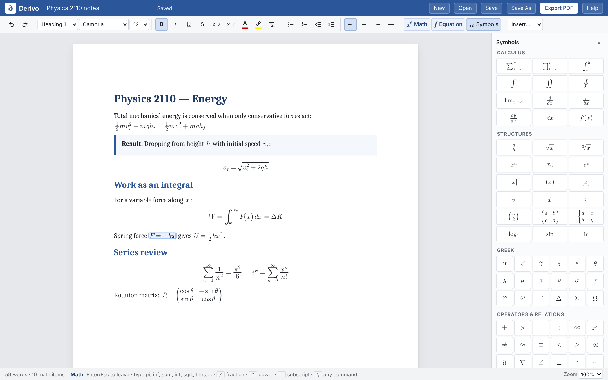

# ∂ Derivo

**A word processor built for math.** Write notes like you would in Word, and type equations as fast as you think. Derivo turns `sum`, `int`, `sqrt` and `pi` into properly typeset math as you type. Then save your notes or export a clean PDF.

## Get Derivo
- **Windows:** [Download Derivo-Setup.exe](https://github.com/nickxkontek/Derivo/releases/latest/download/Derivo-Setup.exe). Works on Windows 10 and 11 (64-bit).
- **In your browser:** [Open Derivo](https://nickxkontek.github.io/Derivo/). In Edge or Chrome you can also install it as an app from the address bar.

Both versions work offline and save the same `.derivo` files.

## Features
- **Fast equation typing.** More than 100 autocomplete words (`theta` → θ, `inf` → ∞, `<=` → ≤), with a suggestion list as you type.
- **Real typesetting.** Fractions, radicals, sums, integrals, limits, matrices and cases are laid out the way textbooks do it. Brackets and roots grow to fit their contents.
- **Word-style editing.** Headings, fonts, colors, lists, tables, and Definition, Theorem, Example and Note boxes.
- **Symbol panel.** Click to insert any symbol or structure. Hover a symbol to learn its shortcut.
- **PDF export.** Print-ready pages with sharp vector equations.
- **Copy and paste LaTeX.** Paste text with `$…$` or `$$…$$` (for example, from an AI chat) and it becomes real math. Copying an equation gives you LaTeX.
- **Private by design.** Everything runs on your computer. Notes are never uploaded, and the app collects no data.
- **Auto-save and auto-update.** Your work is kept if the window closes, and the Windows app updates itself.

## Quick start
| To do this | Press or type |
|---|---|
| Insert math in a line of text | `Ctrl+M` or `$` |
| Insert an equation on its own line | `Ctrl+Shift+M` |
| Leave math | `Enter`, `Esc` or `→` at the end |
| Fraction | `/` (e.g. `1/2`) |
| Power / subscript | `^` / `_` |
| Next box (denominator, limits…) | `Tab` |
| Any symbol by name | `\` then the name |
| Words inside math | `"` … `"` |
| Matrix: new row / new column | `Shift+Enter` / `&` |
| Undo an autocorrect | `Backspace` right after it |
| Save / Open / Export PDF | `Ctrl+S` / `Ctrl+O` / `Ctrl+P` |
| All shortcuts | `F1` |

### A few autocomplete words
| Type | Get | Type | Get | Type | Get |
|---|---|---|---|---|---|
| `pi` | π | `sum` | ∑ | `sqrt` | √ |
| `theta` | θ | `int` | ∫ | `lim` | lim |
| `inf` | ∞ | `del` | ∂ | `vec` | v⃗ |
| `<=` | ≤ | `->` | → | `RR` | ℝ |
| `!=` | ≠ | `+-` | ± | `mat` | 2×2 matrix |

## Files
Notes are saved as `.derivo` files. A `.derivo` file is a small JSON file in which each equation is stored as LaTeX, so your notes stay readable by other tools. Files from earlier versions (`.mathnote`) still open.

## How it's built
- `js/math-engine.js`: Derivo's own math engine. It handles editing, autocomplete and layout. It draws radicals, brackets, braces, fraction bars and accents as vector shapes, with no outside libraries.
- `js/app.js`, `index.html`, `css/app.css`: the word processor.
- `desktop/`: the Windows desktop app (Electron).
- `manifest.webmanifest`, `sw.js`: let the browser version install as an app and work offline.

## Feedback
Found a bug or have an idea? [Open an issue](https://github.com/nickxkontek/Derivo/issues).

## License
Copyright © 2026 Nick Kontek. All rights reserved.
